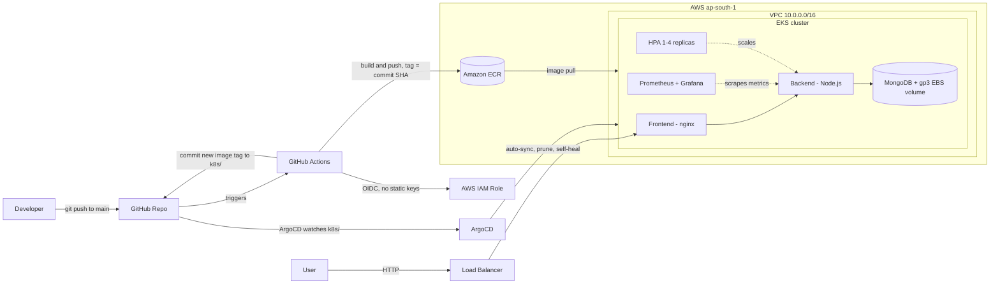
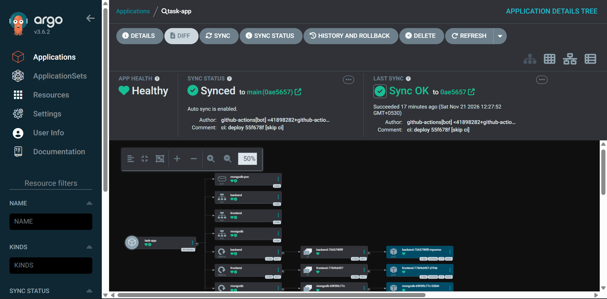
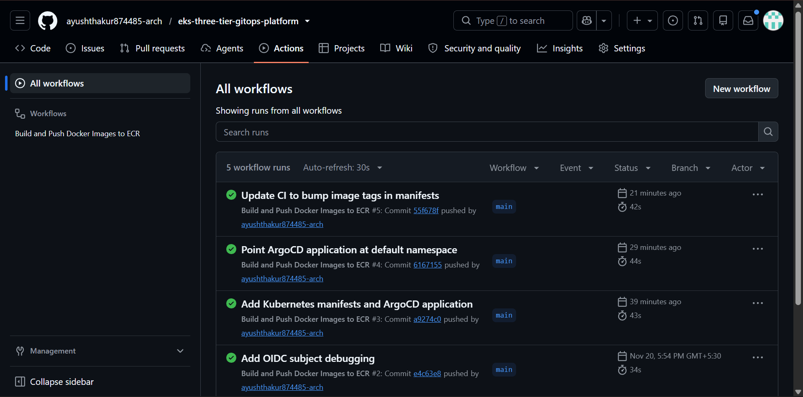
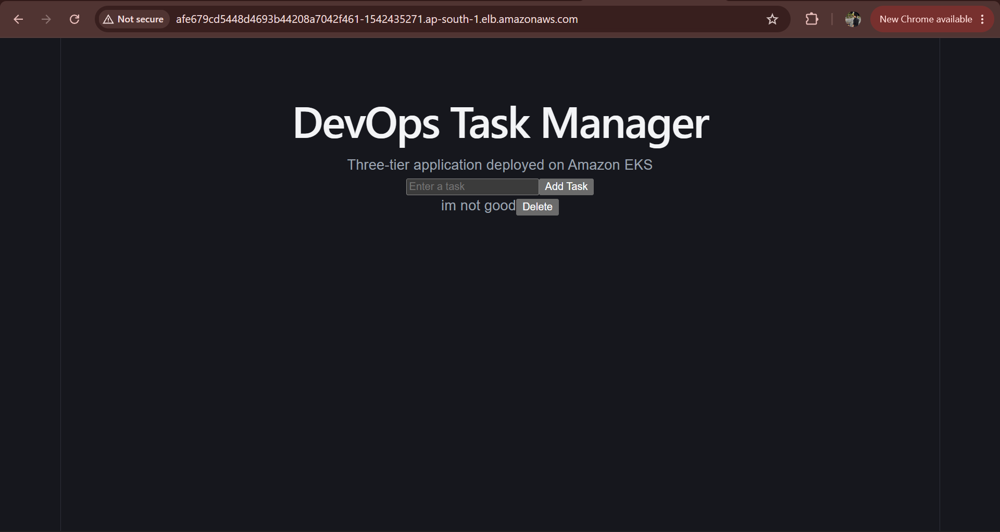
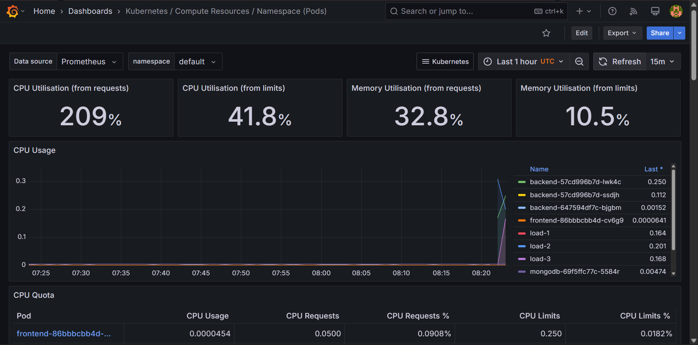
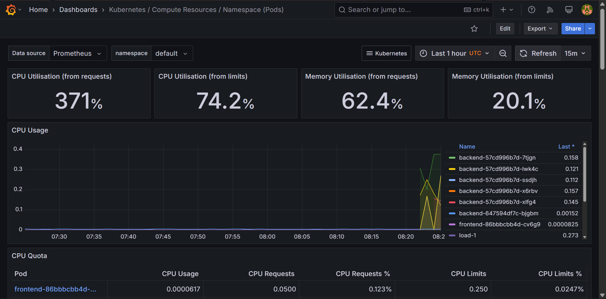

# EKS Three-Tier GitOps Platform

A three-tier application (React frontend, Node.js API, MongoDB) running on **Amazon EKS**, provisioned with **Terraform** and delivered through a fully automated **CI/CD + GitOps** pipeline: **GitHub Actions** builds and pushes images to **ECR** using OIDC (no stored AWS keys), and **ArgoCD** syncs every change from Git to the cluster. **Prometheus and Grafana** provide monitoring, and a **Horizontal Pod Autoscaler** scales the API under load.

> **Region:** `ap-south-1` (Mumbai) · **Kubernetes:** 1.36 · **Nodes:** 2 × `t3.medium` (Amazon Linux 2023)

---

## Architecture



### Delivery flow
1. A push to `main` triggers the GitHub Actions workflow.
2. The workflow authenticates to AWS with **OIDC** (short-lived credentials, no access keys in GitHub).
3. Backend and frontend images are built and pushed to **ECR**, tagged with the **commit SHA** (the repositories use immutable tags).
4. The workflow commits the new tag into the manifests under `k8s/` (`[skip ci]` plus `paths-ignore` prevent a build loop).
5. **ArgoCD** detects the Git change and syncs it to the cluster with auto-sync, pruning and self-heal enabled. No manual `kubectl apply` is needed.

---

## Tech stack

| Area | Tools |
|---|---|
| Cloud | AWS: EKS, VPC, NAT Gateway, ECR, IAM, EBS |
| Infrastructure as Code | Terraform (`terraform-aws-modules` for VPC and EKS) |
| CI | GitHub Actions, OIDC federation to AWS |
| CD / GitOps | ArgoCD (Application with automated sync) |
| Containers | Docker (multi-stage frontend build), Kubernetes |
| Storage | MongoDB 7 on a 5 Gi gp3 volume (EBS CSI driver) |
| Observability | kube-prometheus-stack (Prometheus, Grafana), metrics-server |
| Scaling | Horizontal Pod Autoscaler (CPU based) |

---

## Screenshots

| | |
|---|---|
|  <br> **ArgoCD** syncing the app from Git |  <br> **CI pipeline** runs (build, push, manifest update) |
|  <br> **The app** served from EKS |  <br> **Grafana**: per-pod CPU and memory |

**Autoscaling under load:** a load generator pushed the backend's CPU to roughly 4 to 5 times its request. The HPA scaled the deployment from 1 to 4 replicas in about two minutes (target: 50% average CPU).



---

## Repository structure

```
.
├── .github/workflows/   # CI: build, push to ECR, bump image tags
├── app/
│   ├── frontend/        # React (Vite) app served by nginx
│   └── backend/         # Node.js REST API
├── k8s/
│   ├── frontend/        # Deployment + LoadBalancer Service
│   ├── backend/         # Deployment, Service, HPA
│   └── database/        # MongoDB, PVC, gp3 StorageClass
├── gitops/
│   ├── application.yaml       # ArgoCD Application for the app
│   └── monitoring-app.yaml    # ArgoCD Application for Prometheus/Grafana
├── terraform/           # VPC, EKS, ECR, cluster addons, IAM policy documents
├── monitoring/
├── docs/
└── screenshots/
```

---

## How to deploy

### Prerequisites
AWS CLI (configured), Terraform, kubectl, and a GitHub repository with two **Actions variables**: `AWS_ROLE_ARN` (the OIDC role to assume) and `AWS_REGION`.

### 1. Provision the infrastructure
```bash
cd terraform
terraform init
terraform apply
aws eks update-kubeconfig --name devops-portfolio-cluster --region ap-south-1
```
This creates the VPC (public and private subnets, single NAT gateway), the EKS cluster with a managed node group, the ECR repositories, and the `vpc-cni`, `kube-proxy`, `coredns` and `metrics-server` addons.

### 2. Storage driver
MongoDB needs the **EBS CSI driver** addon with an IAM role (trust and permission policy documents are in `terraform/`). Confirm it with:
```bash
aws eks describe-addon --cluster-name devops-portfolio-cluster --addon-name aws-ebs-csi-driver --region ap-south-1 --query addon.status
```

### 3. Install ArgoCD
Use server-side apply, because ArgoCD's CRDs exceed the client-side annotation size limit:
```bash
kubectl create namespace argocd
kubectl apply --server-side --force-conflicts -n argocd \
  -f https://raw.githubusercontent.com/argoproj/argo-cd/stable/manifests/install.yaml
```

### 4. Hand the cluster to GitOps
```bash
kubectl apply -f gitops/application.yaml
kubectl apply -f gitops/monitoring-app.yaml
```
ArgoCD now deploys the application and the monitoring stack from Git.

### 5. Ship a change
Push to `main`. The pipeline builds the images, updates the tags in `k8s/`, and ArgoCD rolls the new version out.

### Access
```bash
# ArgoCD UI
kubectl port-forward svc/argocd-server -n argocd 8443:443
# Grafana
kubectl port-forward svc/monitoring-grafana -n monitoring 3001:80
```

### Tear down
Delete the load balancer service first so the VPC can be removed cleanly, then destroy:
```bash
kubectl delete svc frontend -n default
cd terraform && terraform destroy
```

---

## Challenges and how I solved them

**1. Node group stuck in `CREATE_FAILED` (`NodeCreationFailure`).**
The EC2 instance booted and registered, but stayed `NotReady`. Working from `nodeadm` console logs, security groups and `kubectl`, I found the cluster had no `vpc-cni`, `kube-proxy` or `coredns` addons, so the node had no pod networking. Declaring them in Terraform (with `before_compute` for the CNI and proxy) fixed it.

**2. GitHub OIDC authentication failures.**
`AssumeRoleWithWebIdentity` was rejected. I added a temporary step that printed the token's subject claim and the repository variables, then compared them with the role's trust policy conditions (`aud`, `sub`) until they matched.

**3. ECR push returning `403 Forbidden`.**
Authentication succeeded but the push failed. I tested the specific ECR API actions the push needs and corrected the IAM role's permissions.

**4. ArgoCD install error: CRD annotation too long.**
`kubectl apply` failed on the ApplicationSet CRD and left one controller crash-looping. Re-applying with `--server-side` fixed it.

**5. Pods stuck `Pending` on a single node.**
A `t3.medium` supports about 17 pods (limited by ENI and IP capacity), and the system pods, ArgoCD and the app exhausted that. The scheduler events showed `Too many pods`. I scaled the node group to two nodes. The module ignores `desired_size` changes, so I set the size once through the AWS CLI and kept Terraform's `min_size` aligned.

**6. Grafana showed no data.**
The data source pointed at `localhost:9090`, which inside the Grafana pod is the pod itself. Pointing it at the in-cluster service DNS name fixed it.

**7. HPA and GitOps interaction.**
A hardcoded `replicas` field in the Deployment conflicts with the autoscaler under ArgoCD's self-heal. The HPA should own the replica count, so the field is left out of the backend Deployment.

---

## Known limitations and next steps

- **Ingress and TLS:** the frontend is exposed through a plain HTTP `LoadBalancer`. Next step: AWS Load Balancer Controller with an ALB Ingress and an ACM certificate.
- **Secrets:** configuration is in plain manifests. Next step: External Secrets or Sealed Secrets.
- **EBS CSI driver** was installed outside the main Terraform file; it should be codified (the IAM policy documents are already in `terraform/`).
- **Network policies and pod security:** not yet restricted to backend-to-database and frontend-to-backend traffic.
- **CI hardening:** add image vulnerability scanning (for example Trivy) and `terraform validate` or `tflint`.
- **Cost:** two nodes, a NAT gateway and a load balancer bill hourly. The cluster is meant to be created for demos and destroyed afterwards.
